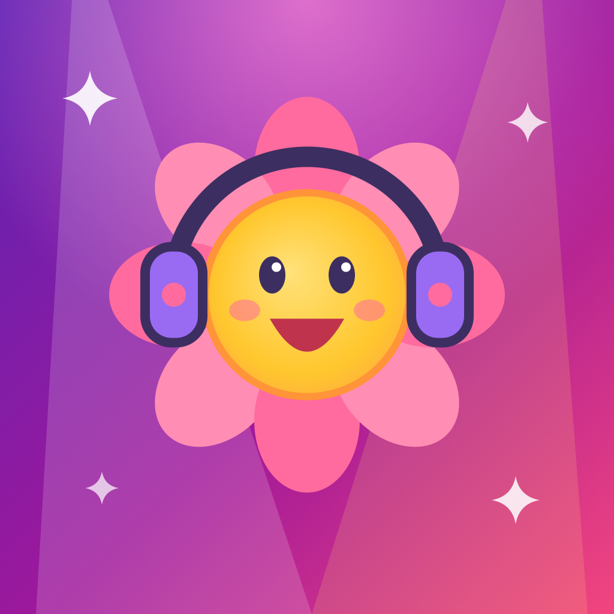

# Flower's Playtime 🌸🎮

Three pop-star games for Flower, with a grown-up lock. Save it to the iPhone home screen and it runs full-screen like an app, even offline. It's a separate app from Flower Learns, with the same look and sound: stage lights, the flower buddy with headphones, and music made in code.



## The games

Every game keeps a score and her **best** score (one per game, saved on the phone). Pass your best mid-round and a gold "New best! 🎉" pops up. At the end, a new high score gets confetti, a fanfare and the flower buddy in star sunglasses. There are no stars, prizes or rewards: she just tries to beat her own best.

| | How to play | Score |
|---|---|---|
| 💿 **Disco Spin** | A record spins in the middle. **Tap** to throw a heart wand into it, without hitting a heart that's already stuck there. Each one that sticks plays the next note of a disco riff. Throw all the wands to clear the level. Later levels spin faster, wobble, stop and go, flip direction, and start with silver hearts already in the way. | 1 per heart that sticks |
| 🎹 **Piano Pop** | Pick a song. Colorful tiles slide down four lanes; **tap** each one to play the next note (with chords and a drum beat in time with the tiles). Let a tile slip off the bottom, or tap an empty spot, and the run ends. The song repeats a little faster each time around ("Faster! 🚀"). | 1 per tile |
| 🐛 **Wiggle Worm** | **Touch and drag** where you want the rainbow worm (with headphones) to go. Gobble the glowing snacks to grow; every snack plays a sparkly note. Computer worms wiggle around too: bump your head into one and the round is over. If a computer worm bumps into *her*, it pops into snacks. | 1 per snack |

Piano Pop songs are public domain or original: *Twinkle Twinkle* (traditional), *Ode to Joy* (Beethoven), *Jingle Bells* (J. Pierpont, 1857), *Can-Can* (Offenbach), and *Spotlight* (an original pop tune). All other music and sound effects are original and made in code.

## The grown-up lock

- Every time the app opens, it shows **"Ask a grown-up to start playtime!"** with a multiplication question (like 7 × 8) on a keypad. A wrong answer gets a new question.
- If the app has been in the background for **more than a minute**, it asks again. A shorter trip away (a notification, a quick app switch) just pauses the game with "Tap to keep playing".
- **🔒 Lock** (top-right of the games menu) closes playtime right away, after an "All done playing?" check.

To change the one-minute grace period, edit `RELOCK_AFTER_MS` in [`public/js/app.js`](public/js/app.js).

## Put it on the iPhone

1. Open **https://flower-playtime.pages.dev** in **Safari** on the iPhone (use the address Cloudflare gives you if it's different).
2. Tap **Share** → **Add to Home Screen** → **Add**. It shows up as **Playtime**.
3. Open it from the home screen and answer the grown-up question. Sound turns on with that first tap (iPhones require a tap before sound), and it plays even with the silent switch on.

High scores are saved on that phone. To reset them, delete the home-screen app (or clear Safari's website data for the site).

## Run it on your computer

Plain HTML, CSS and JavaScript in [`public/`](public): no build step and no dependencies.

```bash
python3 -m http.server 8650 --directory public
# then open http://localhost:8650
```

The service worker (offline mode) is skipped on localhost. Handy test links, which only work on localhost, never on the real site:

- `?play=menu`, `?play=spin`, `?play=songs`, `?play=worm` skip the grown-up lock and open that screen
- `?play=keys-twinkle` (also `keys-ode`, `keys-bells`, `keys-cancan`, `keys-spotlight`) starts a Piano Pop song
- `?reset` clears the high scores

## Deploy (Cloudflare Pages from GitHub)

This is set up the same way as Flower Learns: Cloudflare Pages serves the `public` folder straight from GitHub, and every push to `main` redeploys automatically.

**1. Create the GitHub repo** (once)

1. Go to **https://github.com/new**.
2. **Owner**: `gilzar`. **Repository name**: `flower-playtime`. Private or public both work.
3. Leave **Add a README**, **.gitignore** and **license** all off (the repo must start empty).
4. Click **Create repository**.

**2. Push the code** (from this folder)

```bash
git remote add origin https://github.com/gilzar/flower-playtime.git
```

```bash
git push -u origin main
```

**3. Create the Cloudflare Pages project** (once)

1. Go to **https://dash.cloudflare.com** and sign in.
2. In the left sidebar, open **Workers & Pages** (under **Compute**), then click **Create application** (top right).
3. Choose **Pages**: the **Pages** tab, or the **Get started** link next to "Looking to deploy Pages?". Then choose **Import an existing Git repository** and click **Get started**.
4. Pick the **GitHub** account that already hosts Flower Learns and select **flower-playtime**.
   If it's not listed, click **Configure GitHub App** (or **+ Add account**), allow access to `flower-playtime` on GitHub, then come back and select it.
5. Click **Begin setup**, then fill in:
   - **Project name**: `flower-playtime` (this becomes `flower-playtime.pages.dev`)
   - **Production branch**: `main`
   - **Framework preset**: `None`
   - **Build command**: leave **empty**
   - **Build output directory**: `public`
   - **Root directory** (under *Advanced*): leave empty
6. Click **Save and Deploy**. After about a minute, it shows the live address (**https://flower-playtime.pages.dev**, or the name Cloudflare picked if that one was taken).

After that, every `git push` to `main` updates the site. The home-screen app picks up changes the next time it opens with internet. If you change the list of files in `public/js`, update the `SHELL` list and bump `CACHE` in `public/service-worker.js` so phones save the new version for offline use.

## Project layout

```
public/
  index.html, manifest.webmanifest, service-worker.js, _headers (Cloudflare headers), icons/
  css/app.css        pop-star look (shared style with Flower Learns)
  js/
    app.js           startup, the grown-up lock, re-lock after time in the background
    nav.js           screen switching
    gate.js          grown-up multiplication keypad
    menu.js          games menu + Lock button
    results.js       score bar, "New best!", end-of-round card, pause
    scores.js        high scores (localStorage)
    audio.js         synthesizer, drums, band, music loops, sound effects (adapted from Flower Learns)
    ui.js            flower buddy, stage lights, confetti, DOM helpers (adapted from Flower Learns)
    games/spin.js    Disco Spin
    games/keys.js    Piano Pop (+ song list)
    games/songs.js   Piano Pop songs
    games/worm.js    Wiggle Worm
assets/icon-1024.png full-size icon
scripts/make_icon.swift  draws the icon (macOS): see the comment at the top for the resize commands
```
